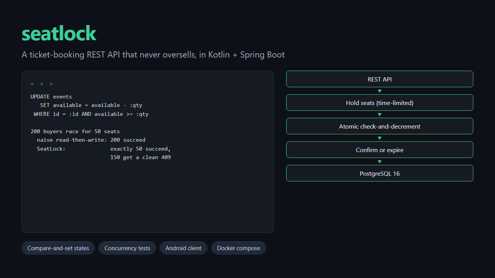

# SeatLock

[](https://github.com/Tendo505/seatlock/actions/workflows/ci.yml)


A ticket-booking REST API in **Kotlin + Spring Boot + PostgreSQL** that **never oversells**, no matter how many buyers hit it at once. Customers place a time-limited **hold** on seats, then **confirm** it. Holds that aren't confirmed expire and their seats go back on sale. Retries are safe thanks to **idempotency keys**.

<p align="center">
  
</p>

The point of the project is the correctness under concurrency, and the tests prove it.

📱 **Android client:** [SeatLock for Android](https://github.com/Tendo505/seatlock-android) (Kotlin + Jetpack Compose) books against this API. [Download the APK](https://github.com/Tendo505/seatlock-android/releases/latest).

## The problem

The obvious way to sell a seat is a race condition:

```kotlin
val available = db.query("SELECT available FROM events WHERE id = ?")   // two buyers both read 1
if (available >= qty) db.update("UPDATE events SET available = ?", available - qty)  // both write 0, both "win"
```

Two requests can read the same `available` value before either writes, and both succeed. I kept this naive version around as an experiment and ran the concurrency tests against it:

| Scenario | Naive read-then-write | SeatLock |
| --- | --- | --- |
| 200 buyers race for 50 seats | **all 200 "succeed"** (150 oversold) | exactly **50** succeed, 150 get a clean `409` |
| 300 random-size orders, 137-seat event | **925 seats** handed out | held + available **= 137**, always |
| 2,000 concurrent 1-seat holds | 2,000 holds, but inventory dropped by only **134** | 2,000 holds, inventory dropped by exactly 2,000 |

## How SeatLock gets it right

**1. Check-and-decrement in one statement.**

```sql
UPDATE events SET available = available - :qty
WHERE id = :id AND available >= :qty
```

The condition and the write are atomic. The row lock taken by the `UPDATE` serialises concurrent buyers, and each one re-checks `available >= :qty` against the latest committed value. Zero rows updated means sold out. As a second line of defence, the schema's `CHECK (available >= 0)` makes the database itself refuse an oversell, even from a buggy code path.

**2. Every state change is a compare-and-set.** A hold moves between states with a guarded update:

```sql
UPDATE holds SET status = 'EXPIRED' WHERE id = :id AND status = 'HELD'
```

Only the caller that gets `1 row` back returns the seats. So when a customer cancels at the same moment the expiry job sweeps that hold, the seats come back **exactly once**, never zero times and never twice. The service keeps no in-memory locks, so it's safe to run many instances against one database, each with its own expiry job.

**3. Idempotency keys that survive concurrent retries.** A client sends `Idempotency-Key: <uuid>` with each purchase attempt. The key is inserted as the **first** step of the transaction, into a table where it's the primary key. If a flaky network makes the client retry while the first request is still running, PostgreSQL makes the second insert *wait* for the first transaction, then fail on the duplicate. That rollback happens before any seats are touched, and the retry replays the original result (`200` + `Idempotent-Replayed: true`). Reusing a key with a *different* body is rejected with `422`.

```
            ┌──────── confirm (before expiresAt) ────────┐
            │                                            ▼
 create ─▶ HELD ── cancel ──▶ RELEASED              CONFIRMED ── cancel ──▶ CANCELLED
            │                                            
            └── expiry job / late confirm ──▶ EXPIRED      (every arrow out of HELD/CONFIRMED returns seats once)
```

## API

| Method | Path | Description |
| --- | --- | --- |
| `POST` | `/api/events` | Create an event (needs `X-Admin-Key`) |
| `GET` | `/api/events?upcoming=true` | List events with live availability |
| `GET` | `/api/events/{id}` | One event |
| `POST` | `/api/events/{id}/holds` | Hold 1–10 seats for 10 minutes. Optional `Idempotency-Key` header. |
| `GET` | `/api/holds/{id}` | Hold / booking status |
| `POST` | `/api/holds/{id}/confirm` | Confirm into a booking (idempotent; fails with `409` once expired) |
| `DELETE` | `/api/holds/{id}` | Release a hold, or cancel a booking; seats go back on sale |

Interactive docs (OpenAPI / Swagger UI) are served at **`/docs`**.

Errors are [RFC 9457](https://www.rfc-editor.org/rfc/rfc9457) `application/problem+json` with stable `type` URIs and useful fields:

```json
{
  "type": "https://github.com/Tendo505/seatlock#not-enough-seats",
  "title": "Conflict",
  "status": 409,
  "detail": "Not enough seats: 2 requested, 1 available",
  "requested": 2,
  "available": 1
}
```

Validation failures list every bad field: `{"errors": {"email": "must be a well-formed email address"}}`.

## Running it

**With Docker** (API + PostgreSQL):

```bash
docker compose up --build
# API on http://localhost:8080, docs on http://localhost:8080/docs
```

**Without Docker** (in-memory H2 in PostgreSQL mode; needs only a JDK 21+):

```bash
./gradlew bootRun
```

Try it:

```bash
# create an event (admin)
curl -X POST localhost:8080/api/events -H 'Content-Type: application/json' -H 'X-Admin-Key: dev-admin-key' \
  -d '{"name":"Jazz Night","venue":"KL","startsAt":"2027-01-15T12:00:00Z","capacity":3}'

# hold 2 seats, safely retryable
curl -X POST localhost:8080/api/events/<eventId>/holds -H 'Content-Type: application/json' \
  -H 'Idempotency-Key: 3f1c9a52-checkout' -d '{"quantity":2,"email":"you@example.com"}'

# confirm
curl -X POST localhost:8080/api/holds/<holdId>/confirm
```

Configuration (environment variables): `SPRING_DATASOURCE_URL` / `_USERNAME` / `_PASSWORD`, `SEATLOCK_ADMIN_KEY`, and `SEATLOCK_HOLD_TTL` (default `10m`).

## Tests

```bash
./gradlew test
```

**29 tests**, run in CI against **both in-memory H2 and a real PostgreSQL 16** service container:

- **Concurrency** (`ConcurrencyTest`): every task waits on a shared start gate so they all hit the database at the same instant.
  - 200 buyers for 50 seats → exactly 50 holds
  - 300 random-quantity orders, repeated 3× → `held + available == capacity`
  - customer cancels racing two expiry sweepers over 60 holds → every seat returned exactly once
  - confirm vs. cancel on the same hold, 30 rounds → one wins, inventory stays consistent
  - 20 simultaneous retries with one idempotency key → exactly one hold
- **Workflow** (`BookingServiceTest`): TTLs with an injectable clock (no `sleep`), late confirmation, idempotent confirm and cancel, expiry sweeps that page through backlogs, and key reuse
- **HTTP** (`ApiTest`): the full flow over MockMvc, admin-key auth, per-field validation, problem+json bodies, idempotent replay headers, 404s and 400s, OpenAPI, and health

A third CI job builds the Docker image, starts it with PostgreSQL through Compose, and smoke-tests the live API.

**Throughput under worst-case contention:** 2,000 concurrent holds for the *same* event, so every request fights over one row lock. On a standard GitHub Actions runner this sustains about **1,500 holds/s on PostgreSQL 16** (about 4,400/s on in-memory H2), and the books always balance.

## Design notes

- **Spring JDBC (`JdbcClient`), not JPA.** The service's correctness rests on a few exact SQL statements, and an ORM's dirty checking would hide them. Each one is visible in [`Repositories.kt`](src/main/kotlin/io/github/tendo505/seatlock/repo/Repositories.kt).
- **Flyway migrations** own the schema, including the `CHECK` constraints that back up the application logic.
- **An injectable `Clock`** makes every time-dependent rule testable without waiting.
- **Constant-time admin-key comparison** (`MessageDigest.isEqual`) avoids leaking the key through response timing.

## Project layout

```
src/main/kotlin/io/github/tendo505/seatlock/
├── domain/Models.kt          Event, Hold, state machine, domain errors
├── repo/Repositories.kt      the SQL: atomic reserve, compare-and-set transitions
├── service/BookingService.kt hold / confirm / cancel / expire / idempotency
├── service/HoldExpiryJob.kt  scheduled sweep
└── web/                      controllers, DTO validation, problem+json errors
src/main/resources/db/migration/V1__schema.sql
```

## License

[MIT](LICENSE) © Tendo505
